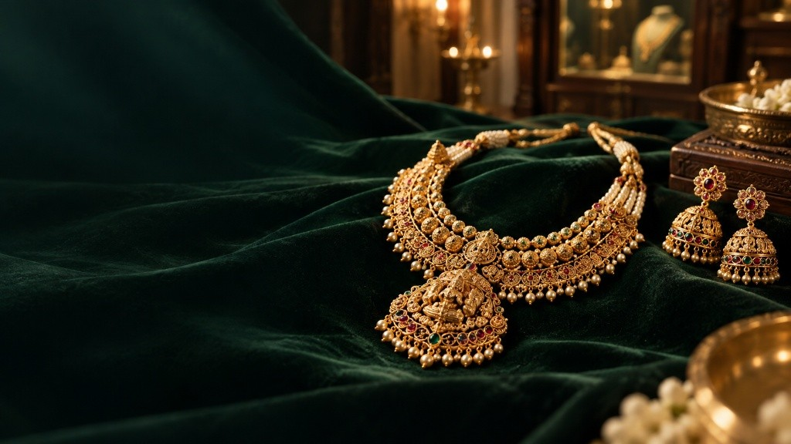
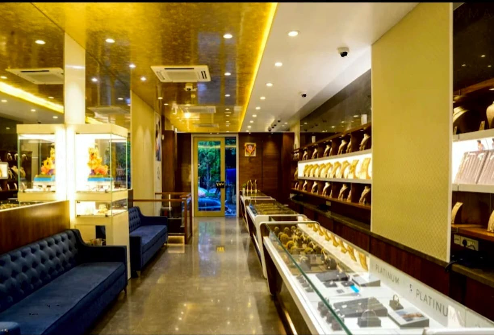
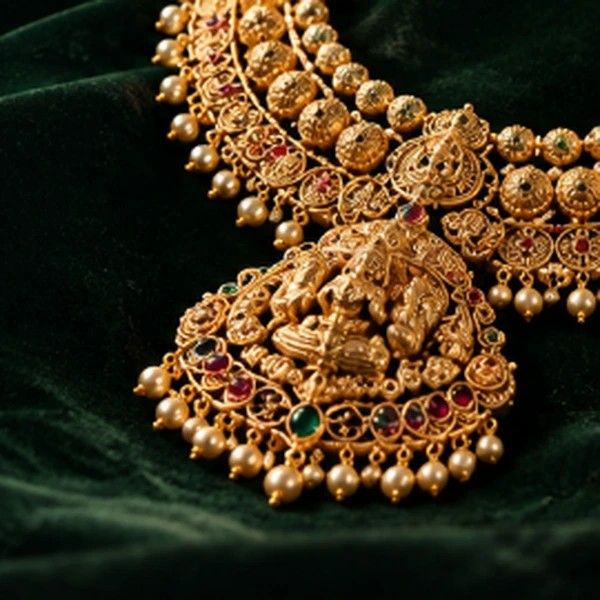
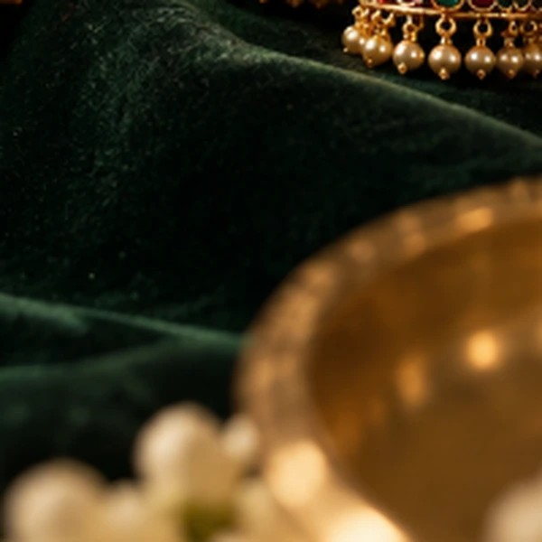
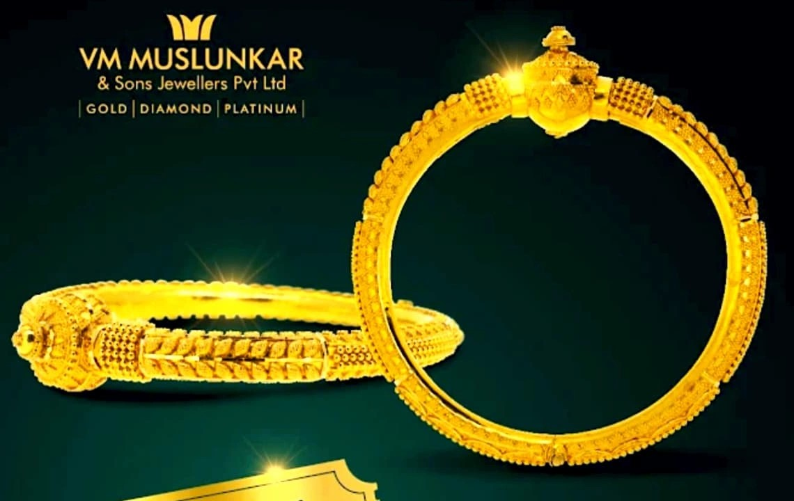

# V.M. Muslunkar — Luxury Jewellery Website Concept

[](https://github.com/shaaunak/muslunkar-concept)
[](https://github.com/shaaunak/muslunkar-concept)
[](https://github.com/shaaunak/muslunkar-concept)
[](https://github.com/shaaunak/muslunkar-concept)

> *"Continuous Maharashtrian gold craftsmanship, quietly refined for generations that carry memory forward."*

An independent, museum-grade editorial website and fine jewellery ecommerce experience designed specifically for **VM Jewellers / V.M. Muslunkar & Sons Jewellers**, an established neighbourhood jeweller founded in 1949 at Relcon House on Mahatma Gandhi Road, Vile Parle East, Mumbai.

---



---

## Executive Overview

This project presents a complete digital transformation for an authentic, third-generation neighbourhood jeweller. Rather than adopting generic ecommerce cards or fast-fashion motifs, the platform embodies the restrained dignity, cultural provenance, and ceremonial authority of historic Maharashtrian gold artistry (Peshwai Toda, Kolhapuri Saaj, and handcrafted temple suites).

The visual language marries deep bottle greens (`#051a16`, `#0b2621`), warm archival ivory (`#fdfaf2`, `#f7f3e9`), and antique metallic gold (`#c3a15b`) with editorial typography (`Playfair Display` and `Plus Jakarta Sans`). Every section has been custom-architected without external frontend frameworks, delivering lightning-fast load times, complete offline capability, and zero runtime overhead.

> **Independent Concept Notice:** This repository contains an independent design proposal and client presentation created by **Shaunak Pitale**. It is not yet the official production website of VM Jewellers Pvt. Ltd. Product specifications, bullion prices, and calculations are illustrative sample demonstrations grounded in authentic store offerings; official quotations, purity testing, and hallmark verification are conducted in person at the Vile Parle showroom.

---

## Visual Showcase

| Cinematic Jewellery Hero | Authentic Showroom Interior |
| :---: | :---: |
|  |  |
| *Editorial negative space with 22K temple choker* | *Shrine of Real Trust: Relcon House consultation chamber* |

| Flagship Temple Suite (Angle 1) | Lakshmi Repoussé Macro (Angle 2) |
| :---: | :---: |
|  |  |
| *Complete 22K choker suite with pearl strands & jhumkas* | *Chased Lakshmi repoussé medallion with ruby droplets* |

| Tiered Floral Jhumkas (Angle 3) | Peshwai Toda Bangles (Angle 1) |
| :---: | :---: |
|  |  |
| *Matched temple jhumkas with hand-strung seed pearls* | *Heavy-gauge 22K toda pair with lion-head terminal finials* |

---

## Key Features & User Experience

### 1. Cinematic Full-Bleed Jewellery Hero
- **Visual Centerpiece**: Features high-resolution emerald-green velvet photography ([`hero_emerald_jewellery.webp`](dist/assets/hero_emerald_jewellery.webp)) showcasing a 22-karat Maharashtrian temple choker necklace, Lakshmi medallion, basra pearls, and jhumkas.
- **Directional Velvet Vignette**: Uses natural negative space on the left for high-contrast editorial typography (*"Some things become part of your story."*), refined CTA buttons, and authentic heritage provenance indicators (*Estd. 1949*, *Bespoke Bridal*, *Relcon House*).
- **Responsive Cropping Protection**: Automatically shifts focus on tablet and mobile viewports so neither the typography nor the jewellery is clipped.

### 2. Chapter I: The Curated Repository (Asymmetrical Editorial Architecture)
- **Museum-Grade Layout**: Replaces monotonous repetitive card grids with an intentional, varied composition:
  - **Dominant 7-Column Card**: *Kolhapuri Saaj & Wati Mangalsutras* with high-relief portrait framing and gold tags.
  - **Companion 5-Column Card**: *Peshwai Toda & Patlya Bangles* with direct multi-angle and sizing triggers.
  - **Horizontal 6-Column Feature Cards**: *The Royal Peshwai Temple Suite* and *Everyday Minimalist Gold*.
- **Interactive Category Filters**: Instant client-side filtering across *All Masterpieces*, *Mangalsutras*, *Temple Suites*, *Peshwai Toda*, *Everyday Gold*, and *Gemstones*.

### 3. In-Store Showroom Selection
- Curated 4-item showcase displaying pieces ready for in-person inspection at the Relcon House showroom, badged with angle counts (*"4 ANGLES · LIVE CALCULATOR"*) and persistent saved piece triggers.

### 4. Chapter II: Roots, Lineage & Cultural Patronage
- Atmospheric deep bottle green container (`#051a16` / `#0b2621`) presenting the sacred significance of gold in Maharashtrian family life.
- Highlights three gold trust pillars:
  - **Purity of Ritual Guarantee**: 100% BIS 916 hallmarked gold with unique HUID traceability.
  - **Ancestral Karigar Guilds**: Preserving living techniques of repoussé (*chitai*), rawa granulation, and kundan jadau.
  - **Unhurried Consultation**: Personal, generational family guidance in Vile Parle East since 1949.
- Framed with an authentic photograph of the showroom interior ([`showroom_interior.webp`](dist/assets/showroom_interior.webp)).

### 5. Chapter III: The Micro-Architecture of the Karigar
- Interactive craftsmanship storytelling module exploring the engineering of the *Peshwai Toda*.
- **Three Pulsing Hotspot Markers**:
  1. *Hand-Soldered Granulation (Rawa Work)*: Microscopic spheres of pure 22K gold hand-rolled and fused at exact flame temperatures.
  2. *Die-Stamped & Hand-Chased Finials*: Lion-head and peacock terminals chased with single-point chisels.
  3. *Antique Geru & Herbal Patina*: Traditional herbal wash highlighting relief polish while creating ancestral shadows.
- Interacting with any hotspot pin or craft card synchronizes the artisan explanation in real time.

### 6. Customer Experiences ("Words from our customers")
- Verbatim Google review excerpts from verified patrons (**Garrgi Doshii**, **shrushti nhivekar**, **Nitin Sawant**) set with fine antique gold dividers, directly linked to verified Google Maps reviews.
- No artificial star ratings, dates, or profile avatars were fabricated.

### 7. Chapter IV: The Vile Parle Atelier
- Features authentic storefront exterior photography ([`storefront_exterior.webp`](dist/assets/storefront_exterior.webp)) showing the *VM JEWELLERS* green fascia at Relcon House on M.G. Road.
- Verified physical showroom details:
  - **Address**: Shop No. 4, Relcon House, Mahatma Gandhi Road, Navpada, Vile Parle East, Mumbai 400057 *(Landmark: Below Maharashtra Co-operative Bank, Near Vile Parle East Station)*.
  - **Landline**: `022 2615 3055` (Click-to-call connected via `tel:+912226153055`).
  - **Directions**: Direct link to verified Google Maps search query.

---

## Major Functionality Upgrade: Individual Product Detail Experience

Navigating to any jewellery piece (e.g., `#/piece/temple-suite` or `#/piece/peshwai-toda`) activates a comprehensive individual product suite:

```
┌───────────────────────────────────────────┬──────────────────────────────────────────────┐
│  INTERACTIVE 4-ANGLE GALLERY              │  SPECIFICATIONS & LIVE VALUATION             │
│                                           │                                              │
│  ┌─────────────────────────────────────┐  │  TEMPLE SUITES · REF: VM-TS-01               │
│  │                                     │  │  The Royal Peshwai Temple Suite              │
│  │  Angle 1 of 4: Full Frontal Suite   │  │  CONCEPT DEMONSTRATION · 100% BIS HALLMARKED │
│  │                                     │  │                                              │
│  │    [ 100% Contained Macro View ]    │  │  SELECT PURITY:                              │
│  │                                     │  │  [ 22KT (91.6% Pure Gold) ]  [ 18KT Gold ]   │
│  │                                     │  │                                              │
│  └─────────────────────────────────────┘  │  SELECT SIZE:   [ View Size Guide 📏 ]       │
│  Caption: Frontal composition on velvet   │  [ 16" Choker ]  [ 18" Standard ]  [ 20" ]   │
│                                           │                                              │
│  ┌────┐  ┌────┐  ┌────┐  ┌────┐           │  LIVE PRICE ESTIMATE BREAKDOWN:              │
│  │Ang1│  │Ang2│  │Ang3│  │Ang4│           │  • Net Gold Value (66.50g):     ₹4,82,125    │
│  └────┘  └────┘  └────┘  └────┘           │  • Gemstones & Pearls Value:      ₹28,000    │
│  [Enlarge Lightbox ⤢]                     │  • Karigar Making Charges (14%):  ₹69,908    │
│                                           │  • Statutory GST (3.0%):          ₹17,401    │
│                                           │  ─────────────────────────────────────────── │
│                                           │  ESTIMATED IN-STORE TOTAL:      ₹5,97,434    │
│                                           │                                              │
│                                           │  [ Reserve for In-Store Viewing ↗ ]          │
│                                           │  [ Enquire on WhatsApp (Demo Preview) ]      │
│                                           │  [ Call Showroom: 022 2615 3055 ☎ ]          │
└───────────────────────────────────────────┴──────────────────────────────────────────────┘
```

1. **Multi-Angle Gallery**: Four genuine macro angles per flagship piece with smooth opacity crossfades, active gold indicator rings, and full-screen lightbox zoom inspection (`dialog.image-dialog`).
2. **Adaptive Canvas Theming**: Viewport dynamically switches between `.dark-canvas` (`#031713`) and `.light-canvas` (`#f7f3e9`) to blend with the original jewellery photography ground.
3. **Purity Selector**: Live toggle between **22KT Yellow Gold** (91.6% purity) and **18KT Fine Gold** (75.0% purity) with instant bullion rate recalculation.
4. **Size Selector & Visual Size Guide**: Interactive size options with dynamic weight multipliers, accompanied by a comprehensive modal guide for Bangles (2.4, 2.6, 2.8, 2.10), Rings (10–18), and Necklaces (16"–28").
5. **Real-Time Price Calculator**: Computes:
   $$\text{Subtotal} = (\text{Net Weight} \times \text{Bullion Rate}) + \text{Gemstones} + \text{Making Charges}$$
   $$\text{Estimated Total} = \text{Subtotal} \times 1.03\quad (\text{Statutory 3\% GST})$$
6. **In-Store Reservation Flow**: Prefills an editable showroom enquiry message with the customer's exact selected purity, size, estimated weight, and reference code.
7. **Persistent Saved Selection**: LocalStorage wishlist synchronized across the header counter, inline heart buttons, and slide-over side drawer (`#drawer`).

---

## Technology Stack & Architecture

| Layer | Implementation | Details |
|---|---|---|
| **Markup & DOM** | Semantic HTML5 | Accessible landmark structure (`<header>`, `<main>`, `<section>`, `<article>`, `<dialog>`, `<aside>`), skip-to-content navigation, and ARIA state attributes. |
| **Styling & System** | Modern Vanilla CSS3 | Custom properties (CSS variables), CSS Grid, Flexbox, responsive typography with `clamp()`, backdrop blurs, and `@media (prefers-reduced-motion)`. |
| **Application Engine** | Modular Vanilla ES6+ | Client-side hash router (`#/`, `#/collections`, `#/saved`, `#/piece/:id`, `#/story`, `#/visit`), dynamic price calculator, reactive DOM updating, zero runtime frameworks. |
| **Typography** | Google Fonts + Local OFL | Primary serif: `Playfair Display` (with local `Cormorant Garamond` fallback); Interface sans: `Plus Jakarta Sans` (with local `Manrope` fallback). |
| **Media & Assets** | WebP + JPEG + PNG | High-efficiency modern WebP formats with fallback JPEGs, preloaded LCP hero image, and retina-ready macro crops. |
| **Dependencies** | **Zero External Packages** | 100% dependency-free, buildless vanilla architecture. No `node_modules`, npm installs, Webpack, or Vite required. |

---

## Project Structure

```
muslunkar-concept/
├── .gitignore                     # Git ignore rules for OS, IDE, env, and backups
├── ANTIGRAVITY_HANDOFF.md         # Design history, prompt instructions, and goals
├── ASSETS.md                      # Complete provenance and image license ledger
├── QA.md                          # Quality assurance matrix and test logs
├── README.md                      # Luxury project presentation documentation
├── RESEARCH.md                    # Business verification matrix & directory citations
├── dist/                          # Production-ready static web application
│   ├── index.html                 # Accessible document shell and semantic markup
│   ├── style.css                  # Complete luxury design system & responsive rules
│   ├── app.js                     # Application engine, router, catalogue, & calculator
│   └── assets/                    # High-resolution media assets & local fonts
│       ├── hero_emerald_jewellery.webp # Cinematic hero velvet & gold centerpiece
│       ├── suite_angle_1_full.webp     # Temple Suite Angle 1: Full composition
│       ├── suite_angle_2_pendant.webp  # Temple Suite Angle 2: Lakshmi repoussé macro
│       ├── suite_angle_3_jhumkas.webp  # Temple Suite Angle 3: Matched jhumkas
│       ├── suite_angle_4_strands.webp  # Temple Suite Angle 4: Basra pearl strands
│       ├── bangle_angle_1_pair.webp    # Peshwai Toda Angle 1: Matched pair
│       ├── bangle_angle_2_terminal.webp# Peshwai Toda Angle 2: Lion finials
│       ├── bangle_angle_3_engraving.webp# Peshwai Toda Angle 3: Repoussé relief
│       ├── bangle_angle_4_beads.webp   # Peshwai Toda Angle 4: Rawa beads
│       ├── storefront_exterior.webp    # Authentic Relcon House storefront photograph
│       ├── showroom_interior.webp      # Authentic showroom consultation counter
│       ├── showroom_showcase.webp      # Authentic showroom illuminated showcase
│       ├── vm_emblem.png               # Authentic gold 3-pointed crown brand mark
│       └── fonts/                      # Offline local font fallbacks (WOFF2)
├── extracted_photos/              # Archival document scans and scanned references
├── licenses/                      # License documentation for open references
└── screenshots/                   # Curated JPEG previews for GitHub documentation
    ├── hero_preview.jpg           # High-resolution hero showcase preview
    ├── suite_full.jpg             # Temple Suite full preview
    ├── suite_pendant.jpg          # Lakshmi medallion macro preview
    ├── suite_jhumkas.jpg          # Jhumkas detail preview
    ├── suite_strands.jpg          # Basra pearl strands preview
    ├── bangle_pair.jpg            # Peshwai Toda preview
    ├── showroom_interior.jpg      # Showroom interior preview
    └── storefront_exterior.jpg    # Storefront exterior preview
```

---

## Getting Started & Local Development

This project runs natively in any modern web browser without a build step or package manager.

### Prerequisites
- Python 3.x (standard on macOS and Linux) or Node.js (optional).

### 1. Clone the Repository
```bash
git clone https://github.com/shaaunak/muslunkar-concept.git
cd muslunkar-concept
```

### 2. Launch Local Server
Serve the `dist/` directory using Python's built-in HTTP server:
```bash
python3 -m http.server 5500 --directory dist
```

Alternatively, with Node.js `npx`:
```bash
npx serve dist -l 5500
```

### 3. Open in Browser
Visit [`http://localhost:5500`](http://localhost:5500) in your web browser.

---

## Deployment Instructions

Because the project is completely self-contained within [`dist/`](dist/), it can be deployed to any static host with zero build configuration:

- **GitHub Pages**: Set Source to `Deploy from a branch`, select `main`, and folder `/dist`.
- **Cloudflare Pages**: Set build output directory to `dist`. Leave build command blank.
- **Vercel**: Set root directory to `dist` or set output directory to `dist`.
- **Netlify**: Set publish directory to `dist`.

---

## Verified Business Information

Information corroborated from Google Maps business listings, TownParle records, and local directories:

| Attribute | Verified Record |
|---|---|
| **Signboard Display** | *VM JEWELLERS* (facia signage at Relcon House) |
| **Registered Name** | *VM Jewellers Pvt. Ltd.* |
| **Heritage / Former Name** | *V.M. Muslunkar & Sons Jewellers* |
| **Established** | 1949 by Vasant Mahadev Muslunkar |
| **Physical Address** | Shop No. 4, Relcon House, Mahatma Gandhi Road, Navpada, Vile Parle East, Mumbai, Maharashtra 400057 |
| **Landmark** | Below Maharashtra Co-operative Bank, Near Vile Parle East Railway Station |
| **Telephone** | `022 2615 3055` (Verified landline) |
| **Core Product Lines** | 22K Gold Ornaments, Silver Articles, Kolhapuri Saaj, Mangalsutras, Gemstone Jewellery |

---

## Quality Assurance & Verification

- **Syntax Validation**: `node -c dist/app.js` executed with 0 errors.
- **CSS Balance**: 399 open and 399 closed curly braces verified via automated parser.
- **Asset Integrity**: 100% of referenced image and font assets verified on disk with zero missing links.
- **Headless Routing**: Simulated and verified all client-side routes (`#/`, `#/collections`, `#/saved`, `#/piece/temple-suite`, `#/piece/peshwai-toda`, `#/story`, `#/visit`).
- **Mathematical Integrity**: Calculator formulas tested and corroborated against statutory Indian gold pricing models.

---

## Developer Credit & Contact

Designed and engineered by:

**Shaunak Pitale**  
Department of Computer Engineering  
Fr. Conceicao Rodrigues College of Engineering (Fr. CRCE), Mumbai  
GitHub: [@shaaunak](https://github.com/shaaunak)  

---

*© 2026 Shaunak Pitale. Private luxury design concept for client presentation. All rights reserved.*
